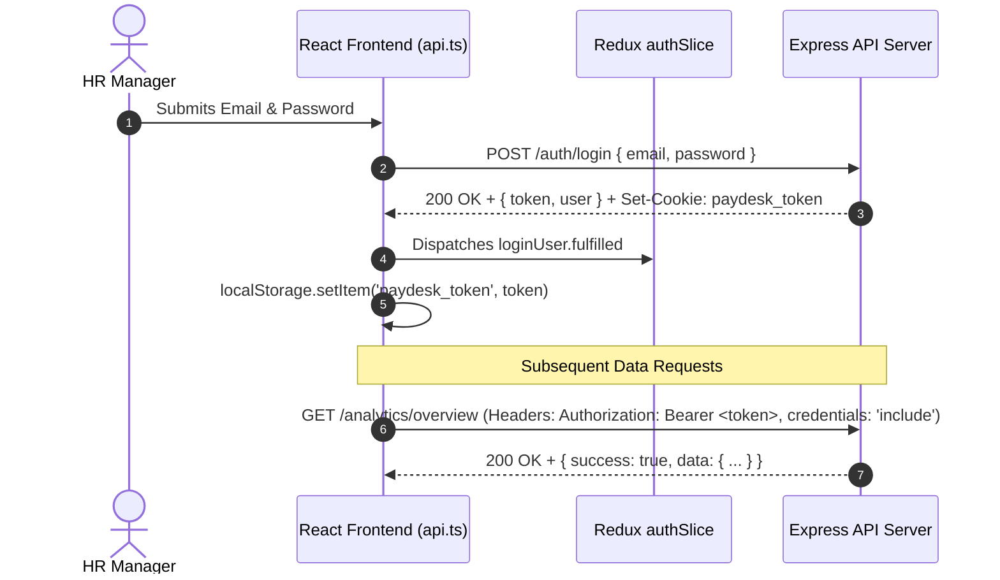

# PayDesk HRMS — Frontend API Integration & Data Layer

## 1. API Client Overview (`services/api.ts`)

The frontend interacts with the backend REST API through a centralized `apiRequest` utility function:

```typescript
export async function apiRequest<T>(endpoint: string, options: RequestInit = {}): Promise<T>
```

---

## 2. Dynamic Base URL Resolution
To guarantee zero-configuration local development while supporting deployed staging and production environments, the base URL is resolved hierarchically:

```typescript
export const API_BASE_URL = 
  import.meta.env.VITE_API_BASE_URL || 
  import.meta.env.VITE_API_URL || 
  'http://localhost:5000/api/v1';
```

---

## 3. Dual-Token Authentication Flow



### Why Dual Authentication?
1. **Third-Party Cookie Privacy Blockers**: Modern browsers (Safari ITP, Brave, Chrome Incognito) frequently block third-party cross-origin cookies.
2. **Bearer Token Resilience**: Attaching `Authorization: Bearer <token>` guarantees that requests from the Render frontend origin to the Render backend origin are never dropped due to strict cookie policies.

---

## 4. Authenticated Export & Download Flow (`utils/download.ts`)
Standard browser `<a href="...">` links fail when downloading protected files because they do not transmit custom `Authorization` headers.

PayDesk uses `downloadExport`:
1. Fetches the endpoint with `fetch(url, { headers: { Authorization: 'Bearer ...' }, credentials: 'include' })`.
2. Inspects `Content-Type`:
   - If `text/html` (e.g. printable payslip), it opens a native window and triggers `window.print()`.
   - If binary/file (e.g. CSV or Excel), it streams as a `Blob`, creates a synthetic `URL.createObjectURL(blob)`, and triggers an automatic browser save dialog.
3. Automatically revokes the object URL to prevent memory leaks.

---

## 5. Error Handling & Toast Feedback
- Network errors and non-2xx responses are mapped to descriptive messages.
- The UI triggers non-intrusive notifications via `showSuccessToast` and `showErrorToast` in `utils/toast.ts`.
- Form validation errors are captured and displayed inline directly under the offending input field.
