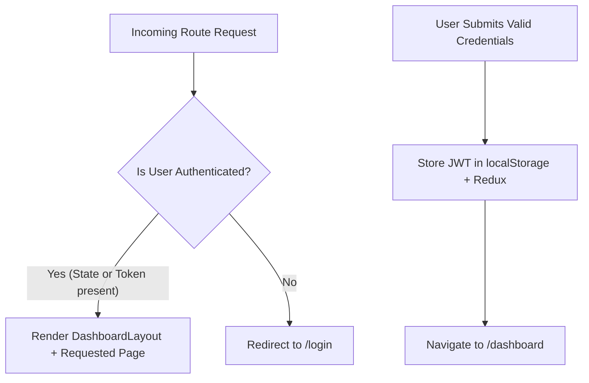

# PayDesk HRMS — Frontend Architecture & Component Structure

## 1. Architectural Philosophy
PayDesk Frontend is structured around the **Feature-Driven Modular Architecture (FDM)** pattern. It decouples core domain features (User, Salary, Employees, Analytics) while sharing reusable atomic design components (Card, Modal, Button, Skeleton).

---

## 2. Directory Structure

```text
src/
├── assets/                  # Static assets and branding
├── components/
│   ├── common/              # Atomic UI components
│   │   ├── Card.tsx         # Unified card wrapper with headers/actions
│   │   ├── Modal.tsx        # Accessible dialog with backdrop click dismissal
│   │   ├── Select.tsx       # Standardized dropdown selector
│   │   └── Skeleton.tsx     # Animated loading skeleton placeholders
│   ├── dashboard/           # Specialized dashboard visualization widgets
│   │   └── DashboardCharts.tsx  # Native SVG charts (Progression, Departments, Countries)
│   └── salary/              # Five specialized compensation workspace tabs
│       ├── EmployeeSalaryTab.tsx
│       ├── SalaryStructureTab.tsx
│       ├── DeductionsLopTab.tsx
│       ├── IncrementsBonusesTab.tsx
│       └── SalarySlipsTab.tsx
├── context/                 # Context providers
├── features/
│   └── user/                # Redux user slice, async thunks, and auth services
│       ├── types.ts
│       ├── userSlice.ts
│       └── userService.ts
├── hooks/
│   ├── useDebounce.ts       # Debounce hook for real-time search queries
│   └── useOnClickOutside.ts # Hook for dismissing modals/dropdowns on outside click
├── layouts/
│   └── DashboardLayout.tsx  # Master application shell with sidebar & header
├── pages/                   # Top-level view routes
│   ├── AIAssistant.tsx      # Natural language compensation assistant
│   ├── Analytics.tsx        # Deep-dive compensation analytics
│   ├── AuditLogs.tsx        # Compliance audit trail viewer
│   ├── Dashboard.tsx        # Executive summary dashboard
│   ├── Employees.tsx        # 10,000+ employee directory
│   ├── Login.tsx            # Authentication page
│   ├── NotFound.tsx         # 404 handler
│   └── Salaries.tsx         # Central salary workspace host
├── services/
│   └── api.ts               # Authenticated API request service
├── store/
│   ├── hooks.ts             # Typed useAppDispatch and useAppSelector
│   └── index.ts             # Redux store configuration
├── types/                   # Global TypeScript interface definitions
├── utils/                   # Pure helper functions
│   ├── currency.ts          # Indian Rupee (formatINR) and multi-currency helpers
│   ├── download.ts          # Authenticated blob file streaming utility
│   └── toast.ts             # Standardized user notification helpers
├── App.tsx                  # Application routing & route protection
├── index.css                # Global design tokens and Tailwind base rules
└── main.tsx                 # Entrypoint attaching Redux Provider & React DOM
```

---

## 3. Core Architectural Modules

### 3.1 State Management (Redux Toolkit)
- **Central Store** (`store/index.ts`): Configures global store using Redux Toolkit.
- **User Slice** (`features/user/userSlice.ts`):
  - State: `{ currentUser, isLoading, isInitialLoading, error }`
  - Thunks: `loginUser`, `fetchCurrentUser`, `logoutUser`.
  - Resilience: `isInitialLoading` is initialized synchronously based on whether `localStorage.getItem('paydesk_token')` exists.

### 3.2 Network Layer (`services/api.ts`)
- Base URL dynamically falls back: `import.meta.env.VITE_API_BASE_URL || import.meta.env.VITE_API_URL || 'http://localhost:5000/api/v1'`.
- Intercepts requests to automatically attach `Authorization: Bearer <token>` when available.
- Always sets `credentials: 'include'` to allow HTTP-only session cookies.
- Parses JSON responses and maps HTTP errors cleanly into rejectable Promises.

### 3.3 Route Protection (`App.tsx`)


---

## 4. Engineering & Documentation Artifacts

- [ai-prompts.md](ai-prompts.md) — Prompts or instructions used with AI tools
- [requirements.md](requirements.md) — Frontend scope, user personas, and acceptance criteria
- [ui-design.md](ui-design.md) — Design system, themes, and responsive layouts
- [testing.md](testing.md) — Vitest test architecture covering components, tabs, and pages
