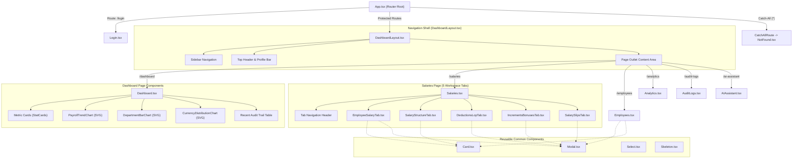

# PayDesk HRMS — Frontend Component & Navigation Diagram

This document illustrates the hierarchical relationship between routes, layouts, pages, and interactive components.

---

## 1. Top-Level Route & Component Hierarchy

---

## 2. Salary Workspace Component Breakdown

```mermaid
graph TD
    SalariesWorkspace["Salaries.tsx (Container)"]

    SalariesWorkspace -->|"activeTab = 'directory'"| Tab1["EmployeeSalaryTab"]
    Tab1 --> FilterBar["Search & Department Filter"]
    Tab1 --> DirectoryTable["Paginated Salary Table"]
    Tab1 --> ViewDetailsModal["Salary Breakdown Details Modal"]
    Tab1 --> ExportMenu["Export Dropdown (CSV, Excel, PDF)"]

    SalariesWorkspace -->|"activeTab = 'structure'"| Tab2["SalaryStructureTab"]
    Tab2 --> EmpSearch["Employee Search Autocomplete"]
    Tab2 --> CompOverview["Compensation Component Cards"]
    Tab2 --> LeaveCard["Paid Leave Balances Widget"]
    Tab2 --> EditStructureModal["Edit Base & Structure Modal"]

    SalariesWorkspace -->|"activeTab = 'deductions'"| Tab3["DeductionsLopTab"]
    Tab3 --> DeductionsTable["Statutory Deductions Table"]
    Tab3 --> DeductionModal["Deduction Breakdown Modal"]

    SalariesWorkspace -->|"activeTab = 'increments'"| Tab4["IncrementsBonusesTab"]
    Tab4 --> RevisionForm["Initiate Revision Form"]
    RevisionForm --> ModeToggle["Toggle: Monthly Increment vs Annual Base"]
    Tab4 --> AuditTrailTable["Revision Audit Trail Table"]

    SalariesWorkspace -->|"activeTab = 'slips'"| Tab5["SalarySlipsTab"]
    Tab5 --> SlipsGrid["Monthly Payslip Card Grid"]
    Tab5 --> PayslipModal["Interactive Styled Payslip Modal"]
    Tab5 --> DownloadSlip["Download HTML Payslip Action"]
```

