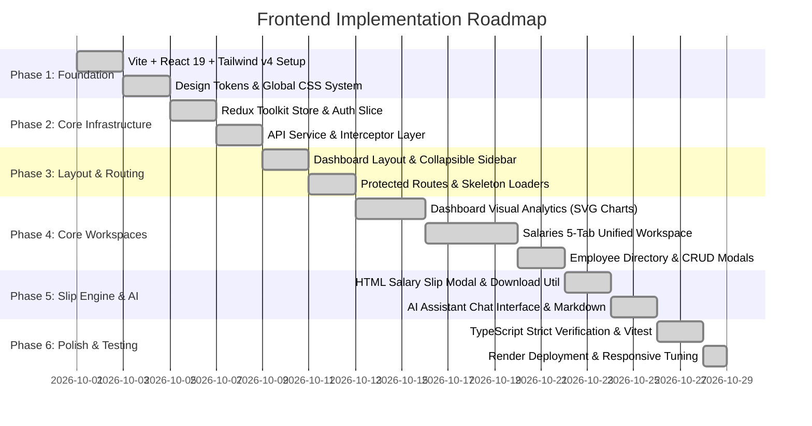

# PayDesk HRMS — Frontend Project Planning & Implementation Roadmap

## 1. Planning Methodology
The frontend was designed using an agile, component-driven approach. Work was segmented into six sequential phases to ensure structural integrity, atomic design reusability, and continuous validation.

---

## 2. Implementation Phases & Milestones

---

## 3. Detailed Phase Breakdown

### Phase 1: Foundation & Design Tokens
- Initialized React 19 with Vite, TypeScript 5+, and Tailwind CSS v4.
- Defined CSS variables for theme colors (`--background`, `--foreground`, `--card`, `--border`, `--primary`).
- Enforced monochromatic slate theme with `#4f46e5` brand indigo accents.

### Phase 2: State Management & Service Layer
- Configured Redux Toolkit (`store/index.ts`) with typed hooks (`useAppDispatch`, `useAppSelector`).
- Created `userSlice.ts` to manage authentication, initial loading state, and user profile persistence.
- Built `api.ts` with dual credential inclusion (`Authorization: Bearer` and `credentials: 'include'`).

### Phase 3: Layouts & Shell Architecture
- Designed `DashboardLayout.tsx` featuring:
  - Collapsible desktop sidebar and mobile off-canvas drawer.
  - Active route highlighting using `lucide-react` icons.
  - Header with user profile badge and quick logout.
- Created `Skeleton.tsx` for visual skeleton states across cards, tables, and charts.

### Phase 4: Salary & Directory Workspaces
- Implemented `/salaries` page with five sub-tabs:
  - Tab 1: `EmployeeSalaryTab.tsx`
  - Tab 2: `SalaryStructureTab.tsx`
  - Tab 3: `DeductionsLopTab.tsx`
  - Tab 4: `IncrementsBonusesTab.tsx`
  - Tab 5: `SalarySlipsTab.tsx`
- Built `/employees` directory with server-side pagination controls and cascading deletion dialog.

### Phase 5: Exporting & AI Assistant
- Implemented `download.ts` utility for authenticated file downloads (CSV, Excel, standalone HTML slips).
- Implemented `AIAssistant.tsx` conversational interface with auto-scrolling message streams and pre-built query chips.

### Phase 6: Hardening, Testing & Deployment
- Replaced third-party chart dependencies with native SVG visualizations for performance.
- Automated Vitest unit testing for Redux slices, toast helpers, and currency formatters.
- Deployed to Render with automatic static site generation (`tsc -b && vite build`).
